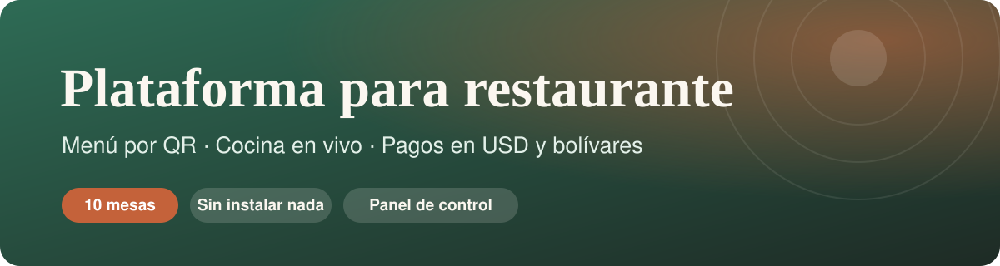
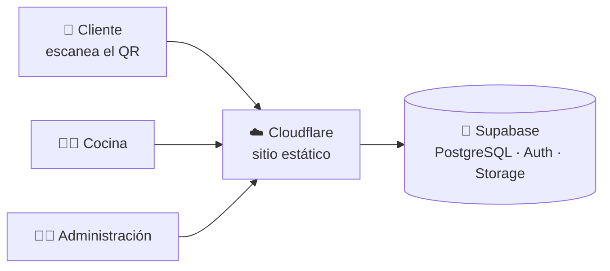
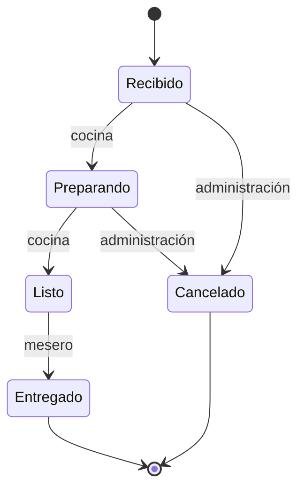

<p align="center">
  
</p>

<p align="center">
  <b>Menú por QR · Cocina en vivo · Pagos en USD y bolívares · Panel de administración</b><br>
  Una plataforma completa para un restaurante de comida rápida de 10 mesas.
</p>

<p align="center">
  
  
  
  
  
  
  
</p>

<p align="center">
  
</p>

---

## ✨ Qué hace

<table>
  <tr>
    <td width="50%" valign="top">
      <h3>📱 Menú por QR</h3>
      Cada mesa tiene su propio código. El cliente ve el menú con fotos, arma su pedido, escribe indicaciones por plato y sigue el estado paso a paso. Sin instalar nada.
    </td>
    <td width="50%" valign="top">
      <h3>👩‍🍳 Cocina en vivo</h3>
      Los pedidos llegan con alerta de sonido, foto y especificaciones de cada plato. Pestañas Nuevos, Preparando y Listos, con temporizador por pedido.
    </td>
  </tr>
  <tr>
    <td valign="top">
      <h3>💳 Pagos con comprobante</h3>
      El cliente elige la forma de pago, llena sus datos y sube la foto del comprobante. El administrador lo revisa y aprueba o rechaza.
    </td>
    <td valign="top">
      <h3>💵 Dólares y bolívares</h3>
      Precios en USD y conversión a Bs. con la tasa del día. Cada pedido guarda la tasa usada para que las cuentas siempre cuadren.
    </td>
  </tr>
  <tr>
    <td valign="top">
      <h3>🧾 Cobros por mesa</h3>
      Qué consumió cada mesa, cuánto lleva pagado, cuánto falta y quién pagó. Todo con barra de progreso y visor de comprobantes.
    </td>
    <td valign="top">
      <h3>🛠️ Panel de control</h3>
      Menú con fotos, precios y disponibilidad, mesas y enlaces QR, formas de pago, tasa del día y pedidos en tiempo real.
    </td>
  </tr>
</table>

<!--CAPTURAS-->

## 🧭 Cómo funciona



El recorrido de un pedido:



## 🔐 Seguridad

- **Los precios y totales los calcula la base de datos.** El navegador solo envía qué plato y cuántos.
- **Row Level Security** en todas las tablas y permisos mínimos por rol (administración, cocina y mesero).
- **QR con código largo e impredecible.** Nadie puede pedir en una mesa que no escaneó.
- **Acceso del personal por código al correo**, solo para correos autorizados.
- **Comprobantes en almacenamiento privado**, visibles solo con enlaces temporales.
- **Historial de cambios** en catálogo, tasas, formas de pago y cancelaciones.

## 🗂️ Estructura

```text
.
├── public/                  Sitio completo (HTML, CSS y JavaScript sin dependencias)
│   ├── index.html           Menú del cliente (se abre con el QR de la mesa)
│   ├── admin/               Panel de administración
│   ├── cocina/              Pantalla de cocina
│   └── assets/              Lógica y estilos compartidos
├── supabase/
│   ├── migrations/          Esquema de la base de datos, versionado
│   ├── seed/                Datos iniciales
│   └── tests/               Pruebas SQL de las reglas críticas
├── scripts/                 Utilidades (configuración, pruebas, SQL unificado)
├── docs/                    Arquitectura, seguridad e imágenes
└── wrangler.jsonc           Despliegue en Cloudflare
```

## 🚀 Puesta en marcha

1. **Base de datos:** crea un proyecto en Supabase y aplica los archivos de `supabase/migrations` en orden. Después carga `supabase/seed/01_base.sql`.
2. **Conexión:** `sh scripts/set-config.sh "https://TU-PROYECTO.supabase.co" "TU_CLAVE_PUBLICA"`
3. **Despliegue:** conecta el repositorio en Cloudflare Workers; el archivo `wrangler.jsonc` ya trae la configuración.
4. **Primer uso:** entra a `/admin/`, registra la tasa del día, agrega tus formas de pago y comparte los QR de las mesas.

Más detalle en [`docs/ARQUITECTURA.md`](docs/ARQUITECTURA.md) y [`docs/SEGURIDAD.md`](docs/SEGURIDAD.md).

## 🗺️ Hoja de ruta

- [x] **Base:** esquema SQL, seguridad y funciones
- [x] **Cliente:** menú, QR por mesa, carrito, notas por plato y seguimiento
- [x] **Cocina:** estados en vivo, fotos, alertas y temporizador
- [x] **Pagos:** formas de pago, comprobantes y revisión
- [ ] **Administración:** gestión de usuarios del personal, informes de ventas y QR imprimibles
- [ ] **Producción:** dominio propio, correo profesional y guía operativa

---

<p align="center">
  Hecho con constancia desde Venezuela 🇻🇪
</p>
